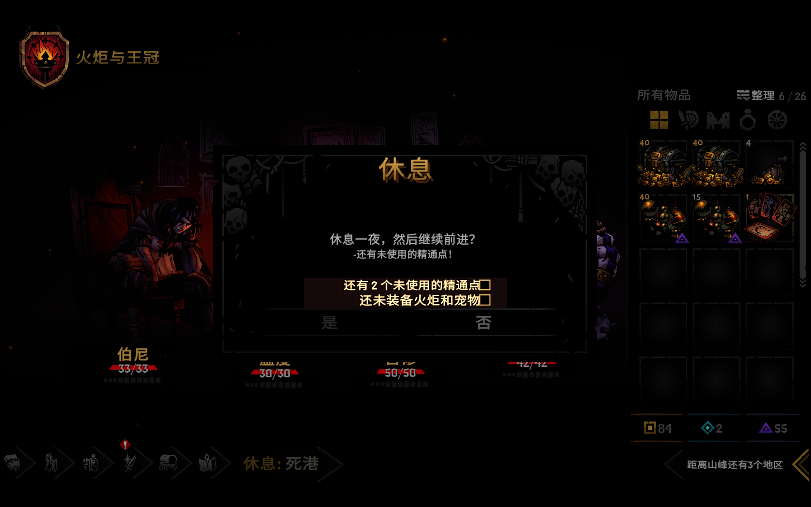

# 《暗黑地牢 II》山谷旅馆提醒

在山谷旅馆点击「休息」时，确认框会显示未使用的精通点数量，以及马车尚未装备的火炬或宠物。勾选所有显示项才能点「是」。点「否」可返回分配精通点或调整装备。

## 安装

[下载最新版完整包](https://github.com/wes7072-max/DD2ValleyReminder/releases/latest)。退出游戏，将完整包解压到游戏 EXE 所在目录。已安装 BepInEx 5 的玩家，只需复制 BepInEx/plugins/DD2ValleyReminder 文件夹。这个插件可独立使用。

交流反馈 QQ 群 **1131198228**。
